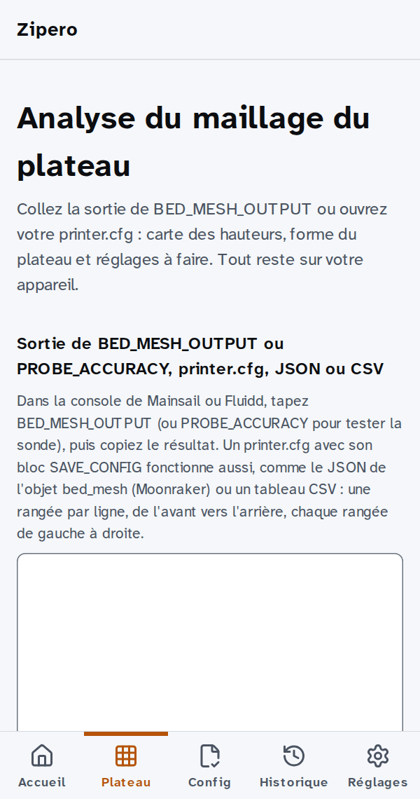

<!-- SPDX-License-Identifier: GPL-3.0-only -->

# zipero-klipper-core

[](https://zipero.fr/outils/analyse-bed-mesh)
[](https://zipero.fr/en/tools/bed-mesh-analyzer)

*[English below](#english)*

Cœur d'analyse de [Zipero](https://zipero.fr), l'assistant de diagnostic **Klipper** : parseurs
et règles de diagnostic (maillage de plateau, `printer.cfg`, macros Jinja2, `klippy.log`,
G-code), écrits en TypeScript pur, sans DOM, exécutables dans Node.js comme dans un Web Worker.
Sur zipero.fr, l'analyse tourne dans le navigateur : les fichiers ne quittent pas l'appareil.

<p align="center">
  
</p>

Image fixe du résultat : [`docs/demo.png`](docs/demo.png). Sur GitHub, les images animées
suivent par défaut le réglage « mouvement réduit » de votre système.

## Installation

Trois commandes (Node.js 24.21 ou plus récent) :

```sh
git clone https://github.com/CyrilleLeS/zipero-klipper-core.git
cd zipero-klipper-core
npm ci
```

Puis `npm test` (tests et couverture) et `npx tsc --noEmit` (types).

## Exemple

```ts
import { computeMeshMetrics, parseBedMeshOutput } from "./src/index.ts";

// Copié depuis la console de Mainsail ou Fluidd après BED_MESH_OUTPUT.
const output = `// Mesh Leveling Probed Z positions:
// -0.050000 -0.042500 -0.035000
// 0.000000 0.007500 0.015000
// 0.050000 0.057500 0.065000`;

const result = parseBedMeshOutput(output);
if (result.ok) {
  const [mesh] = result.value;
  const metrics = computeMeshMetrics(mesh.probed);
  console.log(`Écart total : ${metrics.range.toFixed(3)} mm`); // Écart total : 0.115 mm
}
```

Ce code est exécuté tel quel par les tests du paquet (`src/readme.test.ts`). Le paquet n'est pas
publié sur npm : ses sources TypeScript s'importent depuis un outil qui les compile (Vitest,
Vite, esbuild…). Le cœur ne produit jamais de texte pour l'utilisateur : des codes stables et des
paramètres, traduits par l'interface.

## Contribuer et signaler

- Bugs, faux positifs de diagnostic, idées : les *issues*.
- Correctifs : voir [`CONTRIBUTING.md`](CONTRIBUTING.md). Ce dépôt est un miroir du dépôt de
  Zipero : une PR acceptée y est reprise, avec son auteur crédité, puis republiée ici.
- Faille de sécurité : jamais dans une issue publique, voir [`SECURITY.md`](SECURITY.md).

## Licence

**GPL-3.0-only**, voir [`LICENSE`](./LICENSE). Klipper est un projet indépendant, sous licence
GPLv3 ; ce paquet s'appuie sur sa documentation publique et n'est ni affilié ni approuvé par le
projet Klipper.

---

## English

Analysis core of [Zipero](https://zipero.fr/en), the **Klipper** troubleshooting assistant:
parsers and diagnostic rules (bed mesh, `printer.cfg`, Jinja2 macros, `klippy.log`, G-code),
written in plain TypeScript, without the DOM, running in Node.js as well as in a Web Worker. On
zipero.fr, analysis runs in the browser: files never leave the device.

The animation above shows the bed mesh tool on a phone (static result:
[`docs/demo.png`](docs/demo.png)). On GitHub, animated images follow your system's reduced
motion setting by default. The site shown in it is in French; an English version is available.

**Install** (Node.js 24.21 or later): `git clone https://github.com/CyrilleLeS/zipero-klipper-core.git`,
`cd zipero-klipper-core`, `npm ci`. Then `npm test` (tests and coverage) and `npx tsc --noEmit`
(types).

**Example**: see the code above; it runs as is in the package tests (`src/readme.test.ts`). The
package is not published on npm: import its TypeScript sources from a tool that compiles them
(Vitest, Vite, esbuild…). The core never produces user-facing text: stable codes and parameters,
translated by the interface.

**Contributing**: issues are welcome; for patches, see [`CONTRIBUTING.md`](CONTRIBUTING.md) (this
repository is a mirror: an accepted PR is applied upstream with its author credited, then
republished here). **Security issues**: never in a public issue, see [`SECURITY.md`](SECURITY.md).

**License**: GPL-3.0-only, see [`LICENSE`](./LICENSE). Klipper is an independent project licensed
under GPLv3; this package relies on its public documentation and is neither affiliated with nor
endorsed by the Klipper project.
